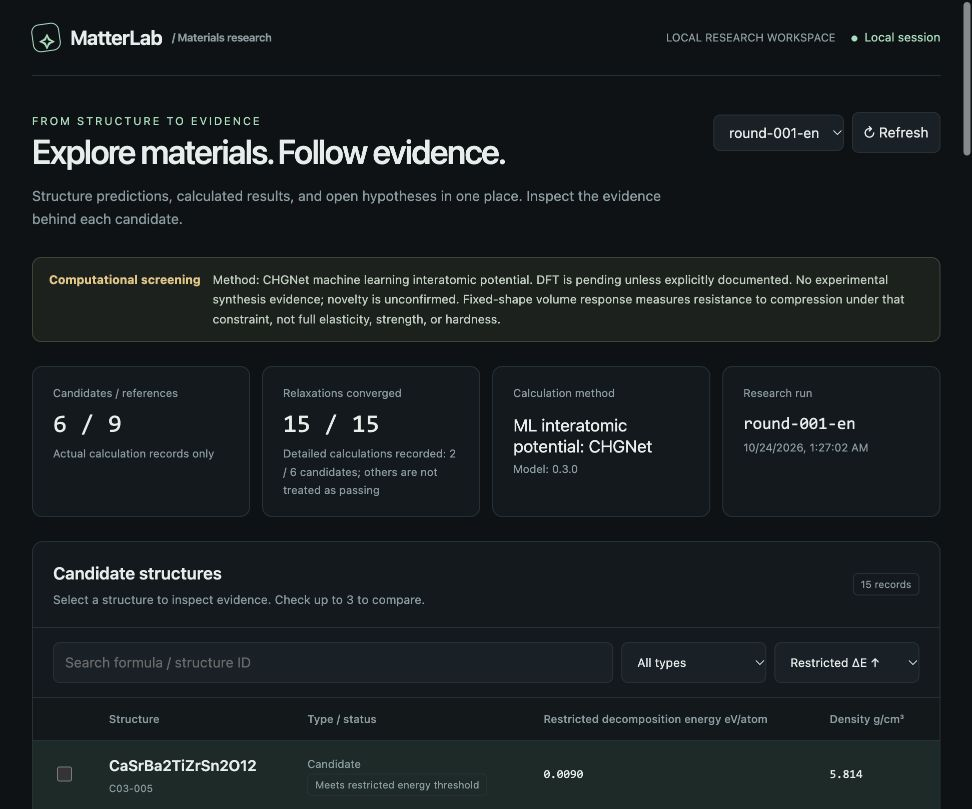

# MatterLab

MatterLab is an open-source platform for computational materials design. It connects composition and atomic ordering, atomistic simulation, and reproducible evidence in a single research workflow.

Built for materials engineers, research teams and scientific developers, MatterLab helps turn configurable material hypotheses into traceable calculations and inspectable candidate dossiers. Its current implementation focuses on multication oxide perovskites.

[Explore results](docs/RESULTS.md) · [Scientific methods](docs/scientific-design.md) · [Model card](docs/MODEL_CARD.md)



## From composition to evidence

1. **Define a design space.** Configure Ca/Sr/Ba and Ti/Zr/Sn occupations in 20-atom oxide-perovskite cells. Enumerate atomic orderings, remove parent-symmetry duplicates and sample reproducibly with fixed seeds.
2. **Calculate structural response.** Relax atomic positions and cells with CHGNet, compare energies against a restricted endmember reference set, and evaluate fixed-shape energy-volume response.
3. **Inspect numerical reliability.** Examine Gamma finite-displacement diagnostics, displacement-step sensitivity, convergence checks and raw force/stress comparisons. Failed and inconclusive checks remain part of the record.
4. **Review and reproduce.** Browse structures and comparisons in the local dashboard; download evidence and replay calculations with recorded configurations, source snapshots, dependency versions and model hashes.

The evidence package includes structures, trajectories, energies, forces, stresses and machine-readable results. The dashboard supports candidate search, comparisons, interactive structure views and evidence downloads.

## Application pathways

These are target research applications, with property requirements that guide subsequent validation—not demonstrated performance of the generated candidates.

| Research application | Properties and validation needed |
| --- | --- |
| Dielectric ceramics for capacitors | Permittivity, dielectric loss, insulation resistance, breakdown field and temperature dependence |
| Electronic-packaging ceramics | Dielectric behavior, thermal conductivity, thermal expansion and compatibility with processing and operating conditions |
| Ceramic-composite fillers | Interface bonding, dispersion, processing compatibility and the target electrical or thermal response of the composite |

Current calculations provide structural, energetic and compression-response evidence, plus limited Gamma diagnostics. Compression response cannot substitute for dielectric, thermal, strength or lifetime measurements. See the [results and application requirements](docs/RESULTS.md) and [model and candidate limitations](docs/MODEL_CARD.md).

**Scientific scope:** Generated candidates are computational hypotheses. CHGNet is a machine-learned interatomic potential, not DFT; global novelty, stability, synthesis and product performance have not been established. Restricted reference comparisons are not a complete phase diagram, and Gamma diagnostics are not full phonon dispersion. The [detailed results](docs/RESULTS.md), [model card](docs/MODEL_CARD.md) and [known-reference DFT limitations](docs/quantum-validation.md) define the evidence boundaries.

## Getting started

Use Python 3.11 or 3.12. The commands below use a POSIX shell and run from the repository root. Dependencies and the local workflow require no model API key.

```sh
git clone https://github.com/CPTM511/matterlab.git
cd matterlab
python3.11 -m venv .venv
.venv/bin/python -m pip install -e .
.venv/bin/matterlab verify runs/round-001-en
.venv/bin/matterlab serve --port 8877
```

After starting the server, open the dashboard URL displayed in your terminal to explore the included results. You can also browse the [published results and documentation](#results-and-documentation) directly in this repository. The read-only server binds to localhost. Substitute `python3.12` when that is the installed compatible interpreter.

### Configure and run a study

```sh
# Generate structures without running atomistic calculations.
.venv/bin/matterlab generate --config configs/round-001.json --output runs/new-design

# Run the configured study in a separate, new output directory.
.venv/bin/matterlab run --config configs/round-001.json --output runs/new-study
.venv/bin/matterlab verify runs/new-study

# Independently replay one candidate and compare saved observations.
.venv/bin/python tools/reproduce_candidate.py \
  runs/round-001-en C03-005 runs/replay-C03-005
```

Start each independent study or replay in a new directory. `run --resume` continues saved work and rejects configuration, environment, checkpoint or source drift; it is not an independent reproduction. Calculations consume local compute and storage. Consult the [scientific design](docs/scientific-design.md) before choosing study settings or interpreting a replay.

## Results and documentation

The included dataset contains 27 symmetry-distinct initial decorations, six calculated candidates and nine reference structures. Two candidates have energy-volume and Gamma analyses; both Gamma assessments are inconclusive.

- [Campaign report](runs/round-001-en/report.md), [machine-readable summary](runs/round-001-en/summary.json) and [integrity checks](runs/round-001-en/verification.json).
- [C03-005 reproduction record](runs/reproduction-round-001-en-C03-005/reproduction.json).
- [Numerical replay and capture report](evidence/repaired-recorder-20261023/REPORT.md), [CPU-dispatch diagnostic](evidence/dispatch-contrast-20261023/REPORT.md) and [same-condition repeatability result](evidence/p1-default-repeat-20261024/result/REPORT.md). Exact pairwise repetition does not resolve the original force/stress acceptance failure or establish physical accuracy.
- [Quantum ESPRESSO reference calculations](docs/quantum-validation.md), including the failed cutoff-convergence check; these do not validate candidates.
- [Novelty and prior-art ledger](docs/NOVELTY.md), [scientific methods](docs/scientific-design.md) and [publication integrity workflow](docs/PUBLICATION.md).

## Architecture and development

The Python package separates structure generation, simulation, numerical analysis, evidence verification and reporting. JSON configurations define the supported design space and study settings; saved source snapshots and dependency records support reproducible investigation. The static dashboard reads the exported result files through the local evidence server.

- [`src/matterlab/`](src/matterlab/): generation, calculators, analysis, evidence, reports and CLI.
- [`configs/`](configs/): study configurations.
- [`ui/`](ui/): evidence dashboard.
- [`tools/`](tools/): reproduction, export and quantum-calculation utilities.
- [`tests/`](tests/): engineering and scientific-analysis checks.

For contributors, install the test dependencies and run the test suite separately from the product quick start:

```sh
.venv/bin/python -m pip install -e '.[test]'
.venv/bin/pytest -q
```

## License

Original MatterLab code is available under the [MIT License](LICENSE). External software, pretrained weights, pseudopotentials and cited data retain their respective licenses; MIT does not relicense those assets. See [third-party sources and licensing](docs/THIRD_PARTY.md).
